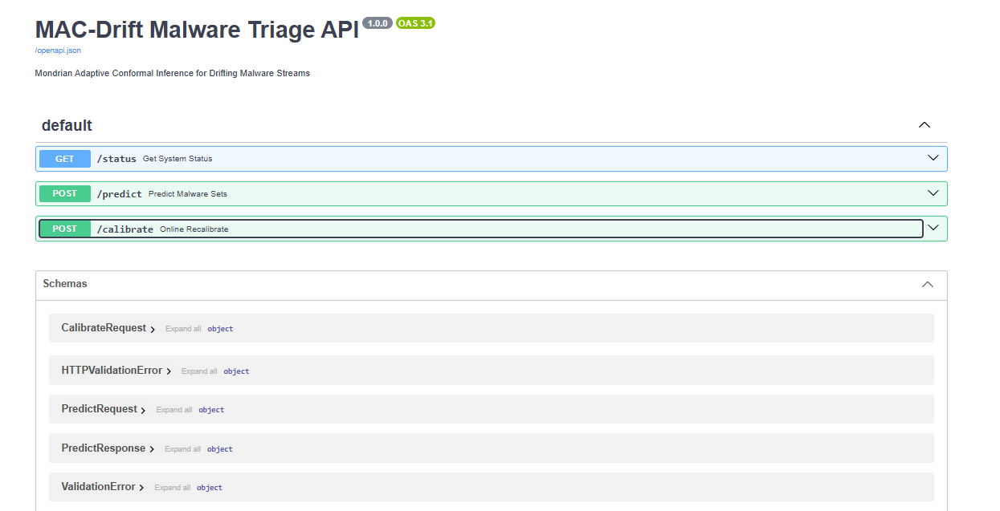
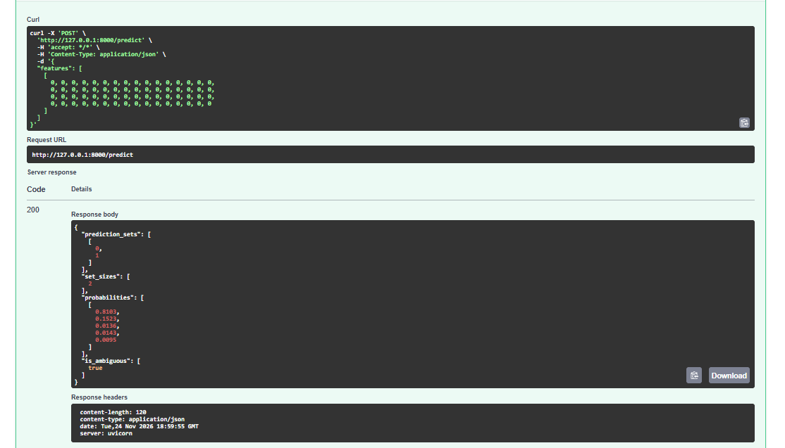
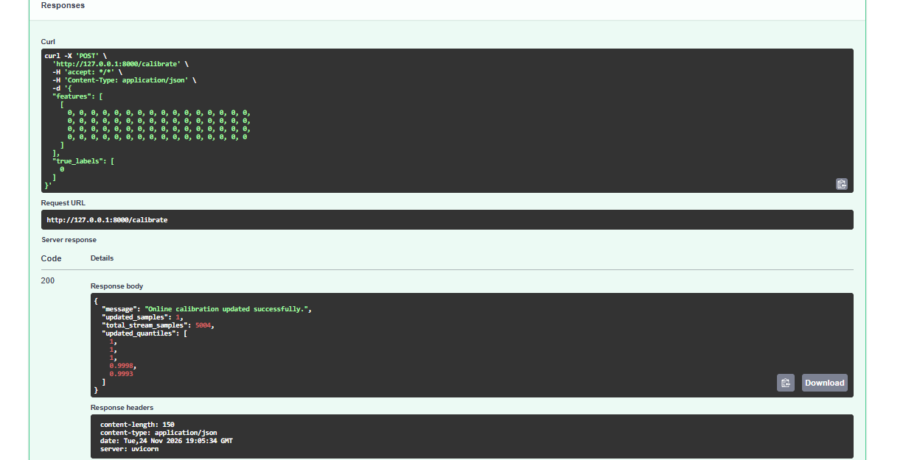

# MAC-Drift: Mondrian Adaptive-Window Conformal Prediction for Continual Malware Family Classification under Non-Stationary Temporal Drift

[](https://www.python.org/)
[](LICENSE)
[](https://fastapi.tiangolo.com/)
[](https://arxiv.org/)

**MAC-Drift** is a distribution-free uncertainty quantification framework designed for continual Portable Executable (PE) malware family classification under non-stationary temporal concept drift and severe class imbalance.

By unifying **Leave-One-Out (LOO) LightGBM bootstrap ensembles**, **Regularized Adaptive Prediction Sets (RAPS)**, **Mondrian class-conditional calibration**, and **Goldenshluger–Lepski adaptive look-back window selection**, MAC-Drift addresses the *marginal coverage trap* on rare malware families while reducing prediction set cardinality by **28.3%** compared to streaming conformal baselines.

---

## System Architecture

<p align="center">
  
</p>

The framework consists of four main components:

1. **Chronological Stream Ingestion (`src/data/`):** Strict temporal sorting using Polars through `TemporalPELoader`, followed by sequential rolling-batch splitting via `TemporalStreamSplitter` to prevent future data leakage.

2. **LOO Bootstrap Ensemble (`src/models/`):** Trains \(B=20\) LightGBM classifiers with rare-class probability alignment (`_align_probabilities`) to compute out-of-bag nonconformity scores without wasting scarce calibration data.

3. **APS / RAPS Scoring Engine (`src/conformal/`):** Computes cumulative probability scores for calibration and rank-penalized RAPS scores at inference, guaranteeing non-empty prediction sets.

4. **Per-Class Lepski Window Optimization (`src/drift/`):** Balances Dvoretzky–Kiefer–Wolfowitz (DKW) variance penalties against empirical drift bias across dyadic candidate windows:

   \[
   \mathcal{W} = \{64,128,256,512,1024,2048\}
   \]

   Window selection is performed independently per class, with hierarchical global shrinkage when class calibration counts fall below:

   \[
   n_{\min}=15
   \]

---

## Key Benchmark Results

Evaluated across **40 sequential streaming batches**, comprising **20,000 test samples** following **5,000 warmup samples**, with a nominal target coverage of:

\[
1-\alpha=0.90
\]

### Benchmark Comparison

| Method | Marginal Coverage | Min-Class Coverage | Max-Class Violation | Avg. Set Size ↓ |
|:---|:---:|:---:|:---:|:---:|
| Fixed-Window (\(W=1000\)) | \(0.9978 \pm 0.0023\) | \(0.9007 \pm 0.1064\) | \(0.0442 \pm 0.0714\) | \(1.6988 \pm 0.0227\) |
| ACI (\(\gamma=0.01\)) | \(0.9978 \pm 0.0023\) | \(0.9007 \pm 0.1064\) | \(0.0442 \pm 0.0714\) | \(1.6820 \pm 0.0255\) |
| ERAPS (\(W=2000\)) | \(0.9978 \pm 0.0023\) | \(0.9007 \pm 0.1064\) | \(0.0442 \pm 0.0714\) | \(1.6988 \pm 0.0227\) |
| **MAC-Drift (Ours)** | **\(0.9882 \pm 0.0076\)** | \(0.8438 \pm 0.0807\) | \(0.0665 \pm 0.0661\) | **\(1.2065 \pm 0.0229\)** |

### Key Findings

- **28.3% Smaller Prediction Sets:** Reduces average prediction set cardinality from approximately 1.70 to **1.2065 classes per file**.

- **79.5% Actionable Singleton Rate:** Resolves nearly four out of five incoming binaries to a single unambiguous malware family label, compared to \(23.8\%-36.6\%\) for the baselines.

- **Zero Empty Prediction Sets:** Maintains a **0.0% empty-set rate**, ensuring that every incoming sample receives at least one candidate label.

### Benchmark Visualizations

<p align="center">
  
  
</p>

---

## Production Microservice & Analyst Triage UI

MAC-Drift includes a FastAPI microservice (`api.py`) for real-time conformal inference and online analyst label feedback.

### Interactive Triage Dashboard & Swagger API

**Endpoints:**
- `/ui` — Interactive analyst triage dashboard.
- `/docs` — Interactive Swagger API documentation.

<p align="center">
  
</p>

### Real-Time Conformal Prediction & Online Recalibration

The service exposes two main operations:

- **`POST /predict`** — Generates conformal prediction sets for incoming PE samples.
- **`POST /calibrate`** — Accepts analyst-provided labels and updates the online calibration process.

<p align="center">
  
  
</p>

---

## Project Structure

```text
mac-drift/
├── configs/                 # Experiment & model hyperparameters
├── data/                    # Chronological PE stream datasets (.parquet)
├── notebooks/               # Drift diagnostics & visualization notebooks
├── results/
│   ├── figures/             # Publication figures & API screenshots
│   ├── streaming_benchmark_results.csv
│   └── table1_summary.tex
├── src/
│   ├── conformal/           # MAC-Drift, ACI, ERAPS, Fixed-Window, APS/RAPS
│   ├── data/                # Polars temporal loader & rolling stream splitter
│   ├── drift/               # Goldenshluger-Lepski selector & KS-drift engine
│   ├── evaluation/          # Marginal, Mondrian, violation & efficiency metrics
│   └── models/              # LightGBM base classifier & LOO bootstrap ensemble
├── tests/                   # Pytest mathematical & Mondrian validity suite
├── api.py                   # FastAPI microservice & analyst UI
├── run_experiments.py       # End-to-end 40-step streaming benchmark runner
└── pyproject.toml           # Package configuration
```

---

## Quickstart

### 1. Installation

Clone the repository and install the package:

```bash
git clone https://github.com/mariam851/mac-drift.git
cd mac-drift
pip install -e .
```

### 2. Run Mathematical & Statistical Validity Tests

```bash
pytest -v
```

### 3. Reproduce the 40-Step Streaming Benchmark

```bash
python run_experiments.py
```

### 4. Launch the FastAPI Inference Service

```bash
uvicorn api:app --host 127.0.0.1 --port 8000 --reload
```

Once the service is running, access the following interfaces:

- **Analyst Triage Dashboard:** http://127.0.0.1:8000/ui
- **Interactive API Documentation:** http://127.0.0.1:8000/docs

---

## Technologies & Frameworks

- **Programming Language:** Python 3.10+
- **Machine Learning:** LightGBM
- **Data Processing:** Polars
- **Conformal Prediction:** APS, RAPS, Mondrian Calibration
- **Adaptive Drift Detection:** Goldenshluger–Lepski, KS Testing
- **API Development:** FastAPI
- **Testing:** Pytest
- **Data Storage:** Parquet

---

## Citation

If you use MAC-Drift in your research, please cite:

```bibtex
@article{ali2026macdrift,
  title={MAC-Drift: Mondrian Adaptive-Window Conformal Prediction for Continual Malware Family Classification under Non-Stationary Temporal Drift},
  author={Ali, Mariam Zakaria Moussa},
  journal={arXiv preprint},
  year={2026}
}
```

---

## License

This project is licensed under the MIT License. See the [LICENSE](LICENSE) file for details.
```
